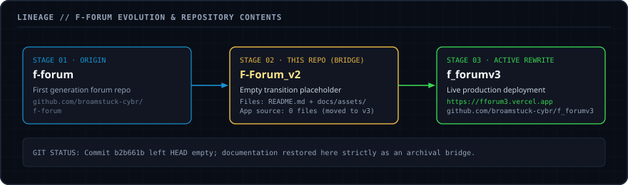
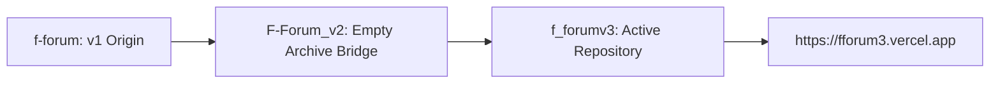

<p align="center">
  
</p>

<p align="center">
  
  
  
</p>

Archival transition repository marking the handoff between the original [f-forum](https://github.com/broamstuck-cybr/f-forum) codebase and the active third-generation platform [f_forumv3](https://github.com/broamstuck-cybr/f_forumv3) (deployed at [https://fforum3.vercel.app](https://fforum3.vercel.app)).

---

## Table of Contents

- [Overview](#overview)
- [Evolutionary Bridge](#evolutionary-bridge)
- [File Structure](#file-structure)
- [Prerequisites and Usage](#prerequisites-and-usage)
- [Scope and Limits](#scope-and-limits)
- [License](#license)

---

## Overview

`F-Forum_v2` contains no application source code. Its git history holds a placeholder transition commit (`b2b661b`) with an empty tree after development moved directly into the third rewrite. Rather than deleting the repository or leaving broken links behind, this page documents the full lineage so visitors arriving at `F-Forum_v2` land cleanly on the live codebase.

---

## Evolutionary Bridge

<p align="center">
  
</p>



| Generation | Repository | Role |
| --- | --- | --- |
| `v1` | [broamstuck-cybr/f-forum](https://github.com/broamstuck-cybr/f-forum) | Initial forum iteration |
| `v2` | `broamstuck-cybr/F-Forum_v2` | Empty archival bridge placeholder (this repository) |
| `v3` | [broamstuck-cybr/f_forumv3](https://github.com/broamstuck-cybr/f_forumv3) | Active codebase, live at [fforum3.vercel.app](https://fforum3.vercel.app) |

---

## File Structure

| Path | Description |
| --- | --- |
| `README.md` | Evolutionary bridge documentation |
| `docs/assets/banner.svg` | Repository header artwork |
| `docs/assets/architecture.svg` | Generational lineage diagram |

---

## Prerequisites and Usage

There is nothing to build or run inside `F-Forum_v2`. If you want to run the application locally or inspect current code, clone `f_forumv3` instead:

```bash
git clone https://github.com/broamstuck-cybr/f_forumv3.git
cd f_forumv3
```

You can also open the live deployment directly at [https://fforum3.vercel.app](https://fforum3.vercel.app).

---

## Scope and Limits

- This repository is kept solely as a permanent archival redirect between `v1` and `v3`.
- No dependencies, environment variables, build scripts, or runtime services exist in this repository.

---

## License

No standalone `LICENSE` file is present in this placeholder repository; see [f_forumv3](https://github.com/broamstuck-cybr/f_forumv3) for current licensing terms.
